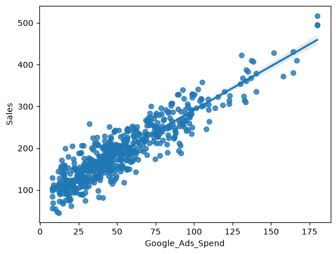
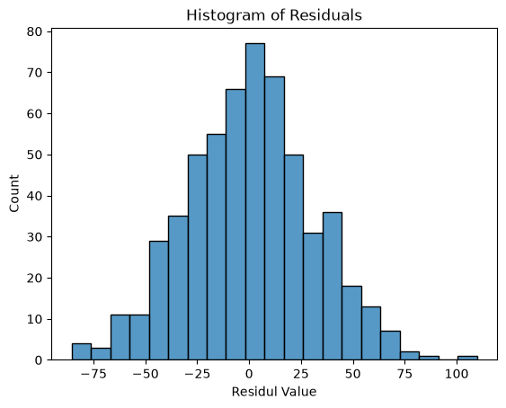
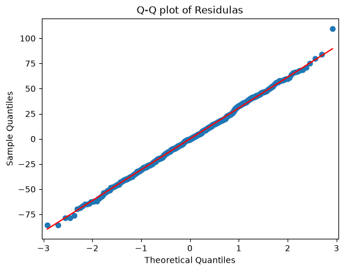
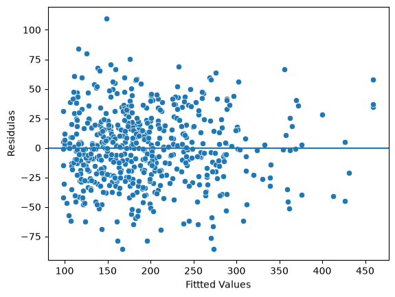

# Google Ads Spend vs Sales: Simple Linear Regression

Does spending more on Google Ads go hand in hand with higher sales? This project uses simple linear regression in Python to measure that relationship for a fictional online electronics store.

## Business Question
The analytics team wants to know whether Google Ads expenditure is associated with sales revenue, to support better marketing budget decisions.

## Dataset
- **File:** `Online_Electronics_Store_Marketing_Sales.xlsx` (fictional, educational data)
- **Size:** 572 rows, 6 columns
- **Columns:** `YouTube_Ads_Spend`, `Google_Ads_Spend`, `Social_Media_Spend`, `Campaign_Type`, `Product_Category`, `Sales`
- **Units:** spend and sales are in thousands of Indian rupees (₹)
- **Cleaning:** rows with missing values were removed, leaving 569 observations

## Method
1. Explored the data (summary statistics, missing values, pairplot)
2. Checked linearity between Google Ads spend and sales
3. Built an OLS model: `Sales ~ Google_Ads_Spend`
4. Validated the model assumptions: normality of residuals (histogram and Q-Q plot), independence and constant variance (residuals vs fitted values)

## Key Results
| Metric | Value |
|---|---|
| R² | 0.828 |
| Slope (Google_Ads_Spend) | 2.0973 |
| Intercept | 81.7155 |
| p-value (slope) | < 0.001 |

**Model:** `Sales = 81.7155 + 2.0973 × Google_Ads_Spend`

## Insights
- Google Ads spend explains about **83% of the variation** in sales.
- Each ₹1 of extra Google Ads spend is **associated with about ₹2.10 more in sales**.
- The residual checks support the linear regression assumptions.

> **Note:** This shows an association, not proof of cause. Other factors, such as other channels, seasonality and product category, may also affect sales.

## Assumption Checks
| Residuals histogram | Q-Q plot | Residuals vs fitted |
|---|---|---|
|  |  |  |

## Next Steps
- Multiple linear regression using YouTube and social media spend
- Compare results by campaign type and product category
- Look for diminishing returns at higher spend levels

## Tools
Python, pandas, NumPy, Matplotlib, Seaborn, statsmodels, Jupyter Notebook

## Files
- `Untitled10.pdf`: PDF export of the notebook
- `Online_Electronics_Store_Marketing_Sales.xlsx`: dataset
- `images/`: charts used in this README

## Author
**Abhisanth K V** · [LinkedIn](https://linkedin.com/in/abhisanth-kv) · [GitHub](https://github.com/kvabhi)
